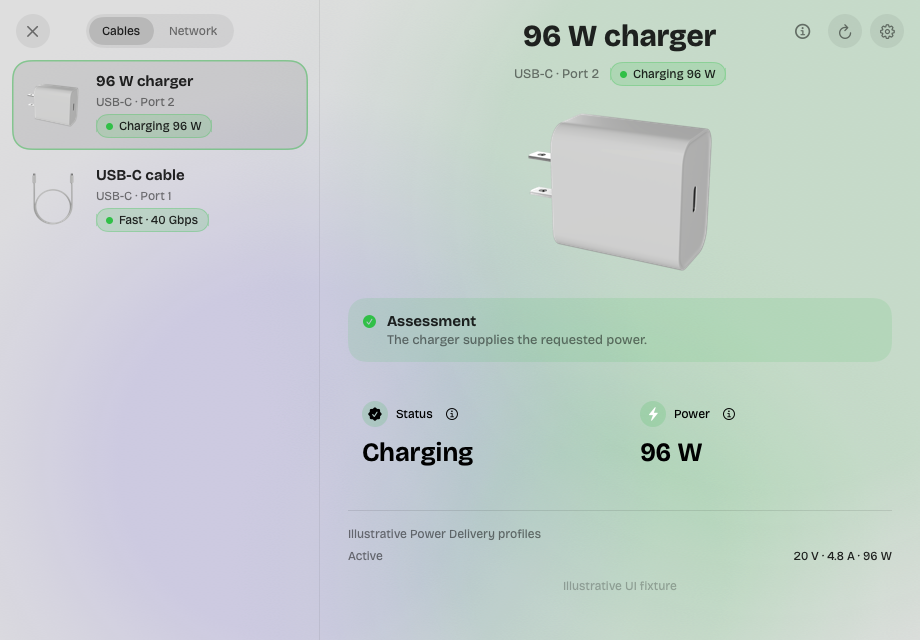

# Strand

A small macOS menu bar app that shows what's plugged into your Mac's USB-C, Thunderbolt, MagSafe and Ethernet ports: what each cable or device is, how fast it runs and how much power it delivers.

macOS 14+ · Apple silicon



## Install

1. [Download Strand](https://github.com/lumen-xx/strand/releases/latest), unzip it and move **Strand.app** to **Applications**.
2. Open it. If macOS blocks it, go to **System Settings → Privacy & Security → Open Anyway**, or run:

```sh
xattr -dr com.apple.quarantine "/Applications/Strand.app"
open "/Applications/Strand.app"
```

3. Click the connector icon in the menu bar, then choose a connection or **Open Strand**.

Strand is signed with a stable local identity but not notarized yet. It reads IORegistry through IOKit and needs no permissions, helper or configuration changes. Launch at login, plug-in notices and automatic update checks are optional and off by default. Closing the window leaves Strand in the menu bar; there is no Dock icon.

## What it does

- Lists each physical port macOS reports with its current connection and active transports. A cable only shows once it connects to another device or charger.
- Shows status and available power together, with the rest as a list. Values macOS doesn't report are hidden rather than guessed.
- Reads near and far cable e-marker identity and per-port USB Power Delivery source options when macOS exposes them. Cable signalling, current, vendor and product IDs and voltage ceilings appear only for recognised identity data; unknown VDO versions stay raw, and EPR voltage tolerance is never turned into a guessed wattage. E-marker parsing is fixture-tested but not yet verified with real e-marked hardware.
- With monitoring on in Settings, draws two-minute graphs of the Mac's input power and USB storage read and write rates. These are system and device readings, not per-cable usage.
- **Network** mode shows this Mac's interfaces, local addresses, traffic, listening TCP ports and visible TCP and UDP sockets, with process names and PIDs where macOS allows. No scanning, packet capture or elevated permissions; tunnel traffic may also appear on the underlying interface, so counters aren't summed.
- **Copy Report** copies the reported facts and their limitations as text.

What macOS reports, and what it doesn't, is in [docs/IOREGISTRY.md](docs/IOREGISTRY.md).

## Updates

Use **Check for Updates…** in the menu bar or app menu. Automatic checks are opt-in. Sparkle verifies the signed archive and feed. Copies of 0.5.7 and earlier read the old lumen-xx/strand-releases feed, which no longer exists: download the next release by hand once to get updates again.

## Build and verify

Requires the Swift 6.2/macOS 26 SDK for the Liquid Glass branches; the package uses swift-tools-version 5.9 and macOS 14 deployment.

```sh
swift run StrandChecks
bash scripts/build-app.sh
open dist/Strand.app
```

The app is arm64 with embedded Sparkle 2.10.0, bundle id com.opyuii.strand, and signed with a stable local identity (Strand Local Signing, created once by `scripts/signing-identity.sh`). Regenerate the icon with `swift scripts/icon.swift work` followed by `iconutil -c icns work/Strand.iconset -o Sources/Strand/Resources/AppIcon.icns`.

The screenshot comes from sample data, never from this Mac's ports: `swift build`, then `.build/debug/Strand --fixture charger-cable --snapshot docs/images/inspector.png --light`. The connection images are Blender renders made by `scripts/render-connection-images.py`; see [docs/PRODUCT_IMAGES.md](docs/PRODUCT_IMAGES.md).

## Releases

Releases are published here, with the signed appcast as a release asset: https://github.com/lumen-xx/strand/releases/latest/download/appcast.xml.

`updates/config.json` holds the feed and public key; the private key lives only in the login Keychain under account `strand`. Don't generate a replacement key for an existing release stream.

```sh
bash scripts/prepare-release.sh 0.5.8 38
bash scripts/publish-release.sh 0.5.8
```

Build numbers must increase. Publishing signs the archive and feed with Sparkle, verifies both signatures and creates the release, marked latest.

## License

[MIT](LICENSE). Third-party notices, including Sparkle's, the Bricolage Grotesque typeface's and the CC BY 4.0 models behind the connection images, are in [THIRD_PARTY_NOTICES.md](THIRD_PARTY_NOTICES.md).
